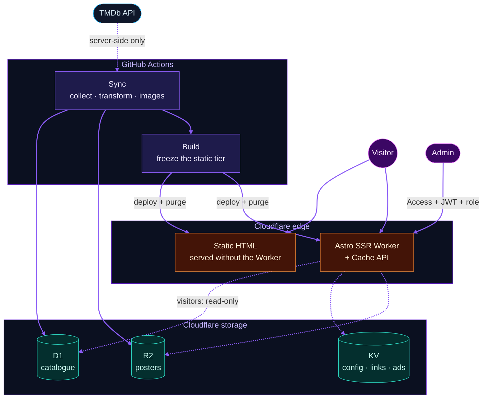

<div align="center">


**A fast, information-only movie & TV catalogue — cast, trailers, ratings and per-country *where to watch* — built on Cloudflare's edge.**


[Highlights](#highlights) · [Features](#features) · [Architecture](#architecture) · [Quick start](#quick-start) · [Admin](#admin-panel) · [Go live](#go-live) · [Docs](#docs)

</div>

> [!NOTE]
> **ScreenPeek never streams, hosts, or links to downloads.** A scheduled job copies catalogue data from [TMDb](https://www.themoviedb.org/) into ScreenPeek's own database, and visitors are served entirely from that store plus poster images on Cloudflare R2 — **no visitor request ever triggers a call to the TMDb API.**

<h2 align="center">Highlights</h2>

<table>
<tr>
<td width="33%" valign="top">🔌 <b>Zero visitor-triggered API calls</b><br/>Visitors read D1 / KV / R2 only. CI fails the build if visitor code references TMDb URLs or imports from <code>sync/</code>.</td>
<td width="33%" valign="top">⚡ <b>Speed budget, enforced in CI</b><br/>First screen stays under <b>100,000 bytes</b>, and Lighthouse mobile scores <b>≥ 90</b> on home, detail and list pages.</td>
<td width="33%" valign="top">🧱 <b>Hybrid static + SSR</b><br/>Hubs and the top-N titles (3,000 by default) are pre-rendered; the long tail is server-rendered at the edge with Cache API caching.</td>
</tr>
<tr>
<td width="33%" valign="top">🖼️ <b>Owned images</b><br/>Posters become WebP once, live in R2 with 1-year <code>immutable</code> caching and ship from an owned custom domain.</td>
<td width="33%" valign="top">🛠️ <b>Full admin panel</b><br/>Behind Cloudflare Access: links, ads, content, SEO, sync, backups, history with undo, trash and a health report.</td>
<td width="33%" valign="top">🪙 <b>Built for free-tier limits</b><br/>A write governor for D1's 100,000 rows/day, a 15,000-file static cap and buffered click / vote counters.</td>
</tr>
</table>

<h2 align="center">Features</h2>

- **Browse** — configurable home, movie & TV pages, seasons & episodes, people with filmography, genre / collection / language hubs, top 10, new and upcoming.
- **Decide** — ratings strip, cast, gallery, similar titles, click-to-load trailers, and per-country **where to watch** (Stream · Free · Rent · Buy for US · GB · CA · AU, credited to JustWatch).
- **Interact** — instant search (SQLite FTS5), *Must Watch / Good / Average / Skip* verdict votes (one per title per day) and a browser-only **My List**. No accounts.
- **Get found** — canonical URLs, Open Graph / Twitter cards with a generated 1200×630 share card per title, JSON-LD, split sitemaps, `noindex` gating, plus editable About / Privacy / DMCA / Contact pages.

<h2 align="center">Architecture</h2>



**Stack** — Astro 7 · Cloudflare Workers with Static Assets · D1 (SQLite + FTS5) · KV · R2 · `sharp` · TypeScript (strict) · `node:test` + Playwright · GitHub Actions.

**Sync, step by step** — `collect` → `filter` → `fetch` → `transform` → `images` → `persist`. Idempotent and budgeted (≤ 2,000 titles and 25 minutes per run, plus a daily D1 write governor); work that doesn't fit is deferred to the next run. Only titles that pass the **quality gate** (poster, overview, popularity, cast or providers) reach listings, sitemaps and static pages.

<h2 align="center">Quick start</h2>

```sh
npm ci                # install the locked dependencies
npm run db:setup      # local D1: schema + migrations + 50 fictional sample titles
npm run dev           # dev server → http://localhost:4321
```

Needs **Node.js 24** (pinned in `.node-version`) — no Cloudflare or TMDb account for local work. While sample data is present the site runs in *sample mode* (`noindex`); run `npm run db:remove-seed` before importing real data, and never apply the seed to a remote database.

| Command | What it does |
|---|---|
| `npm run build` · `npm run preview` | Build the Worker + static tier into `dist/`, then serve it with local bindings |
| `npm run sync:fixture` | Offline importer rehearsal with fictional data — no keys, no network |
| `npm run sync:run -- --local` | Real TMDb import into local D1 / R2 (add `TMDB_READ_TOKEN` to `.env`) |
| `npm run check:boundaries` | Fails if visitor code references TMDb or imports `sync/` |
| `npm run check:performance` | 100 KB first-screen gate + Lighthouse mobile ≥ 90 |
| `npm run test:browser` | All Playwright specs (run after `npm run build`) |

Quality gates: 43 `node:test` files, 28 Playwright specs, the boundary check and the performance gate. The exact CI order lives in `.github/workflows/ci.yml`.

<h2 align="center">Admin panel</h2>

Lives at `/admin/` and is **triple-locked**: Cloudflare Access → signed-JWT verification inside the Worker → a role row in `admin_users` (**Owner · Editor · Ads · Viewer**).

**Modules** — Dashboard (revenue, free-tier meters, health) · Links & Offers · Ads · Show / Hide · Info Pages · Sync · Settings · Backup · SEO · Title & People editors · History · Tools.

- **Undo & audit** — every change is logged with actor and before / after values; one-click undo where safe.
- **Trash** — soft-delete, restorable for 30 days; deleted titles return `410` and are blocklisted so sync can't resurrect them.
- **Conflict-proof** — edits carry a `revision` and stale forms are rejected; field **locks** stop sync from overwriting manual edits.
- **Reliable propagation** — every save mirrors to KV and purges the cache through a retryable outbox.
- **Health report** — failed syncs, missing posters, empty ad slots, hot 404s and quota usage, each with a **Fix** link.

<h2 align="center">Automation</h2>

Remote jobs ship **disabled**: they run only on `main` once the repository variable `SCREENPEEK_SYNC_ENABLED` is `1` (backups use `SCREENPEEK_BACKUP_ENABLED`).

| Workflow | Runs | Does |
|---|---|---|
| `ci.yml` | Push to `main`, PRs, manual | Typecheck → boundaries → test suites → build → static-tier checks → performance gates → Playwright. No credentials needed. |
| `nightly.yml` | Every 3 h (UTC), manual | Sync from TMDb → build the static tier → optional deploy + cache purge |
| `backup.yml` | Daily 09:15 UTC, manual | Private D1 + config backup to a separate R2 bucket; newest **14** kept |
| `money.yml` | Every 30 min, manual | Adsterra stats → D1, Telegram revenue alerts |

Admin **Restore** covers configuration tables only. To recover the catalogue, gunzip a snapshot and apply its `sql` field to a fresh D1 (verified by `tests/backup-roundtrip.test.ts`). One-off ops workflows: `db-bootstrap.yml`, `go-live.yml`, `pacing-fix.yml`, `admin-diagnose.yml`.

<h2 align="center">Go live</h2>

Target: **Workers with Static Assets** (not Pages). Deployment is gated on purpose.

1. **Create** a Worker, a D1 database `movie-db`, a KV namespace, a **public** R2 bucket on an *owned custom domain*, a **separate private** R2 bucket for backups, and a Cloudflare Access app.
2. **Configure GitHub** — add the repository secrets and variables (credentials, resource IDs, buckets, `SITE_URL`, the `SCREENPEEK_*_ENABLED` switches; names are in `.env.example`). Leave `SCREENPEEK_SYNC_ENABLED` unset for now.
3. **Bootstrap** — run `db-bootstrap.yml` against a database *without* sample data, set the Worker secrets with `wrangler secret put`, and add your first `admin_users` owner row.
4. **Verify, then ship** — set `SCREENPEEK_SYNC_ENABLED=1`, run the daily sync manually with *deploy unchecked* (remote sync still writes to D1 / R2), then `npm run deploy`.

> [!WARNING]
> `npm run deploy` **refuses to run** unless deploy is enabled, every Phase 1 task in `TASKS.md` is ticked, tokens and IDs are real, `R2_PUBLIC_BASE` is an owned custom domain (not `r2.dev`, `workers.dev` or `pages.dev`), the backup bucket is separate and private, and the static tier was built from the real catalogue (≤ 15,000 files).

Want a look first? `go-live.yml` launches a `noindex` preview on `workers.dev` — edit its owner-specific values first (see *Forking* below).

<h2 align="center">Status</h2>

| Phase | Focus | State |
|---|---|---|
| **1 · MVP** | Catalogue, sync, admin, CI, backups | **37 / 38 tasks.** The last one, **1.26** (live R2 custom-domain check), is what currently blocks `npm run deploy` — use `go-live.yml` for a preview until a domain is configured. |
| **2 · Growth** | Link A/B splits · Telegram auto-posting · `/on/<provider>/` pages · external ratings · analytics · media manager · request inbox | Planned |
| **3 · Scale** | Push notifications · trivia pages · monthly TMDb reconciliation · quota monitoring · hardening | Planned |

<h2 align="center">Security &amp; privacy</h2>

| 🔐 Security | 🕶️ Privacy |
|---|---|
| Credentials live only in env, GitHub secrets or Worker secrets — deploy tooling refuses secret-like Wrangler vars<br/>Admin = Access **and** JWT verification **and** a role row<br/>Same-origin checks and streamed body-size caps on mutating routes<br/>HTTPS-only outbound redirects; Markdown rendered with raw HTML disabled<br/>Upstream error bodies are never logged or echoed; TMDb requests never follow redirects | No accounts — My List, history and vote markers live in `localStorage`<br/>Votes use a daily hash, with no per-voter records<br/>Trailers load YouTube only after a click<br/>Country preference is a 30-day cookie<br/>With ads enabled, ad networks may process request data under their own policies — review the editable Privacy page |

<details>
<summary><b>Forking? Review these owner-specific values first</b></summary>

<br/>

- `.github/workflows/go-live.yml` — `SITE_URL`, `OWNER_EMAIL`, bucket names, Telegram webhook URL, `GITHUB_REPO` (the default `GITHUB_REPO` also lives in `scripts/deploy-config.mjs` and `.env.example`)
- `scripts/money_check.py` — `DOMAIN_ID`, `EPOCH` · `src/components/admin/AdminPanel.astro` — Adsterra placement IDs and labels
- `public/sw.js` — an ad-network service-worker stub that imports a third-party script: replace or remove it if you don't use that network
- `sync/engine.ts` — pacing rules (12-episode series limit, 5,000 / 2,000 title goals, 5 : 1 interleave)
- `db/migrations/005-trust-pages.sql` — default About / Privacy / DMCA / Contact text
- `wrangler.toml` — placeholder resource IDs and names · `.github/workflows/pacing-fix.yml` — one-time owner job, delete when not needed
- `src/lib/admin/*` — admin dates are shown in Bangladesh time (UTC+6) and stored as UTC

</details>

<h2 align="center">Docs</h2>

| Where | What |
|---|---|
| [`docs/REFERENCE.md`](docs/REFERENCE.md) | Full reference — env vars, runtime settings, database, sync pipeline, routes, admin roles, backups, troubleshooting |
| [`db/README.md`](db/README.md) · [`sync/README.md`](sync/README.md) · [`.github/README.md`](.github/README.md) | Sample DB & seed rules · importer usage & exit codes · workflow notes (the workflow files win if they differ) |
| [`.env.example`](.env.example) · [`TASKS.md`](TASKS.md) · [`THIRD-PARTY-NOTICES.md`](THIRD-PARTY-NOTICES.md) | Every env variable name · phase checklist · asset licences & attribution |

<h2 align="center">Attribution &amp; licence</h2>

- This product uses the **TMDB API** but is not endorsed or certified by TMDB. Movie, TV and people metadata and images originate from TMDb.
- **Watch-provider data is supplied by JustWatch** and credited wherever it appears.
- The TMDb logo (`public/tmdb.svg`) is distributed by Simple Icons under CC0-1.0; brand trademarks remain the property of their owners. See `THIRD-PARTY-NOTICES.md`.
- No `LICENSE` file is included yet — add one before redistributing the code.

<div align="center">

<a href="#readme">↑ Back to top</a>


</div>
